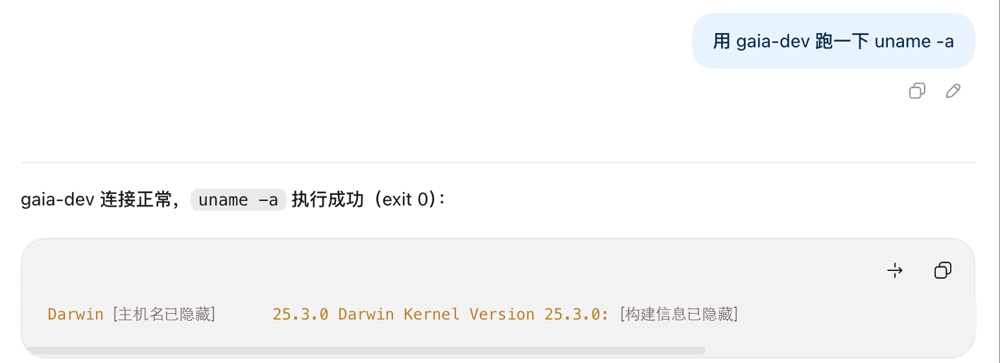

# Gaia Remote Execution

[English](README.md) | 简体中文

Gaia Remote Execution 是一个用于 Codex 的 MCP 项目。它通过 SSH 连接用户配置的具名服务器，在选定的服务器上执行命令并返回结果。仓库包含 `gaia-ssh` 插件、领域说明和设计决策记录。

## 功能

- `gaia.list_connections`：列出已配置服务器的连接信息，不返回密码或私钥。
- `gaia.run_command`：在明确指定的连接上执行一条 Shell 命令。
- 使用预先配置的 SSH 主机公钥或指纹验证服务器身份。
- 每次命令使用独立的远程 Shell；认证后的 SSH 连接可短暂复用，最多空闲 60 秒。
- 对标准输出和标准错误分别限制返回大小，并标明是否截断。

## 运行要求

- Node.js 18 或更高版本。
- 能通过 SSH 登录目标服务器的账户及凭据。
- 事先通过可信渠道核实目标服务器的 SSH 主机公钥或 SHA-256 指纹。

## 安装与配置

在仓库目录中执行：

```sh
cd gaia-ssh-plugin
npm install
npm run init-config
```

初始化命令会创建 `~/.config/gaia-ssh/connections.json`，并将文件权限设置为 `0600`。如果文件已经存在，命令会拒绝覆盖。请编辑该文件，把示例值替换为自己的服务器地址、用户名、认证方式和主机指纹；可删除不需要的示例连接。配置格式可参考 [`connections.example.json`](gaia-ssh-plugin/connections.example.json)。

每个连接都必须填写 `hostKey`，其值可以是完整的 OpenSSH 主机公钥，或以 `SHA256:` 开头的指纹。未知或发生变化的主机身份会被拒绝。密钥认证时，`privateKeyPath` 应填写私钥的绝对路径。

插件启动配置位于 [`gaia-ssh-plugin/.mcp.json`](gaia-ssh-plugin/.mcp.json)。请确保实际加载的插件目录中已安装依赖；若手动配置独立 MCP 服务，需要把启动路径设为该插件目录的绝对路径。

## 使用

先调用 `gaia.list_connections` 查看可用的连接名称，再指定要操作的连接。以下两条是用户在 Codex 对话中发起的请求；`gaia-dev` 是示例连接名，使用时请替换为自己的连接名。

### 范例一：查看远程系统信息

在对话中输入：

```text
用 gaia-dev 跑一下 uname -a
```

对应的 `gaia.run_command` 参数示例：

```json
{
  "connection": "gaia-dev",
  "command": "uname -a"
}
```

截图中命令执行成功（退出码 `0`）；主机名、时间和构建信息已遮盖。



### 范例二：请求安装截图软件

也可以用自然语言描述任务：

```text
在 gaia-dev 安装一个截图软件
```


第二张截图只展示请求，未展示软件选择或安装结果。具体安装方式取决于目标系统和选定软件。[查看完整使用范例](docs/usage-example.zh-CN.md)。

`connection` 和 `command` 必填。可选参数 `timeout_seconds` 默认是 300 秒，范围为 1–3600 秒；`max_output_bytes` 默认每个输出流保留 8192 字节，最大为 65536 字节。输出保留末尾内容；如果前面的内容被截断，结果会明确标记。命令超时后，不能通过此工具恢复该次执行。

## 安全说明

`gaia.run_command` 可以以配置的远程账户身份执行任意 Shell 命令，包括修改或删除文件、安装软件和更改服务。请仅连接可信目标，并在执行前检查命令。

密码认证的密码以明文保存在本机配置文件中。不要将 `connections.json`、私钥或真实凭据提交到 Git 或分享给他人。主机身份验证和显式连接名有助于避免连接到错误的服务器，但不会限制登录后命令的权限。

## 项目结构与开发

- [`gaia-ssh-plugin/`](gaia-ssh-plugin/)：MCP 服务和 Codex 插件。
- [`CONTEXT.md`](CONTEXT.md)：项目术语与行为说明。
- [`docs/adr/`](docs/adr/)：设计决策记录。
- [`CONTRIBUTING.md`](CONTRIBUTING.md)：贡献指南。
- [`SECURITY.md`](SECURITY.md)：安全问题报告方式。

在 `gaia-ssh-plugin/` 目录下运行以下命令，可检查代码语法并执行现有测试：

```sh
npm run check
npm test
```

## 许可证

本项目采用 [MIT 许可证](LICENSE)。
