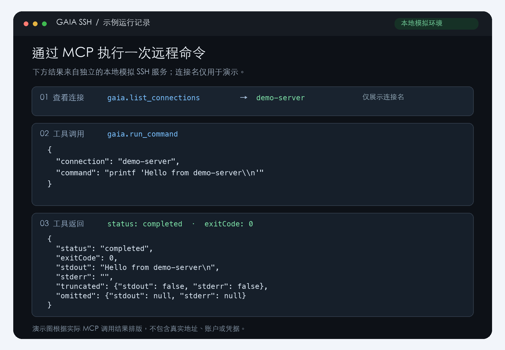

# 使用范例：在指定 SSH 连接上执行命令

本例演示如何列出连接，并在名为 `demo-server` 的目标上输出一行文字。图中的结果来自独立的本地模拟 SSH 服务；`demo-server` 是演示名称。

## 1. 准备连接

按[中文安装与配置说明](../README.zh-CN.md#安装与配置)安装依赖并创建本机配置文件。下面展示密钥认证的配置结构，所有值都是占位符，使用前必须替换为自己的服务器信息：

```json
{
  "connections": {
    "demo-server": {
      "host": "192.0.2.10",
      "port": 22,
      "user": "your-ssh-user",
      "auth": {
        "type": "privateKey",
        "privateKeyPath": "/absolute/path/to/private-key"
      },
      "hostKey": "SHA256:REPLACE_WITH_VERIFIED_FINGERPRINT"
    }
  }
}
```

`192.0.2.10` 是文档示例地址；私钥路径需要填写绝对路径。请通过可信渠道核实服务器的主机指纹，并将 `hostKey` 替换为实际指纹或完整的 OpenSSH 主机公钥。配置文件为 `~/.config/gaia-ssh/connections.json`，应保持权限 `0600`。不要将真实配置或私钥提交到仓库。

## 2. 在 Codex 中发起请求

在可用的 Codex MCP 客户端中加载并启用插件后，可以先让 Codex 列出连接：

```text
请列出我配置的 Gaia SSH 连接。
```

插件会调用 `gaia.list_connections`。返回内容包含连接名、主机、端口、用户名、认证类型和主机身份，不包含密码或私钥。下图只展示了演示连接名；分享自己的截图时，请遮盖不希望公开的主机、用户名和其他连接信息。

然后向 Codex 提出请求（把 `demo-server` 换成自己的连接名）：

```text
请在名为 demo-server 的 Gaia 连接上运行：
printf 'Hello from demo-server\n'
并显示执行状态和输出。
```

对应的 `gaia.run_command` 工具参数为：

```json
{
  "connection": "demo-server",
  "command": "printf 'Hello from demo-server\\n'"
}
```

## 3. 查看结果

成功时，本例的工具结果如下。`exitCode` 为 `0` 表示命令成功；`stdout` 中的 `\n` 是换行符的 JSON 表示。

```json
{
  "status": "completed",
  "exitCode": 0,
  "stdout": "Hello from demo-server\n",
  "stderr": "",
  "truncated": { "stdout": false, "stderr": false },
  "omitted": { "stdout": null, "stderr": null }
}
```



图像根据本地模拟服务器上的实际 MCP 调用结果排版，并非 Codex 界面截图。它只包含演示连接名、命令和输出，没有真实服务器地址、账户或凭据。

> `gaia.run_command` 可以执行任意 Shell 命令。请核对连接名和命令，并使用权限适当的远程账户。
